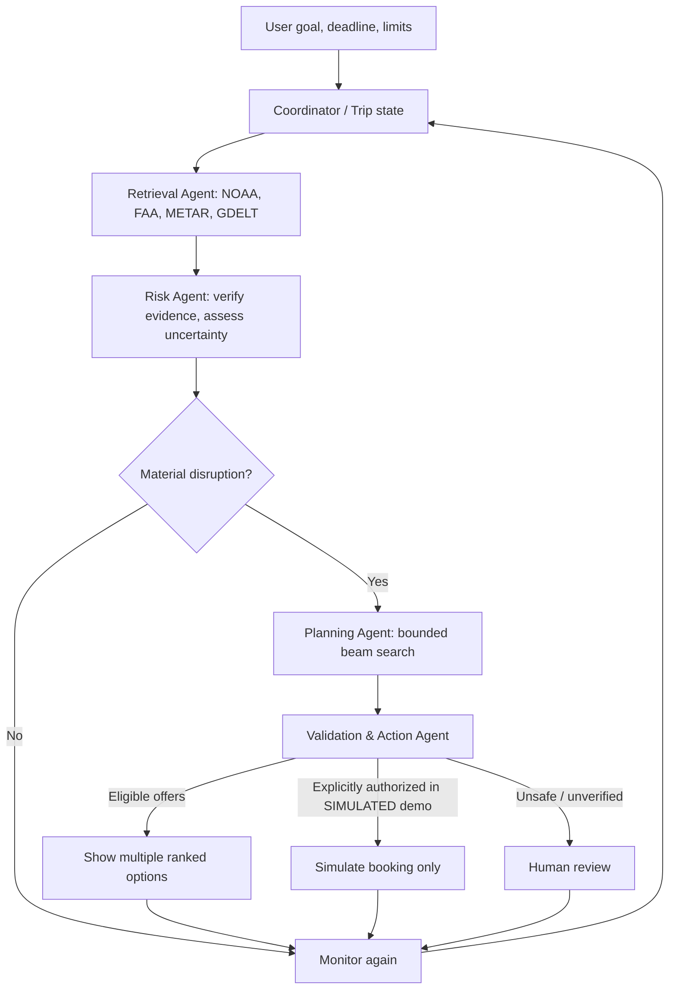

# Travel Risk Agent — Research MVP

A **runnable Python capstone prototype** for proactive travel-disruption monitoring and adaptive alternative-route planning. It implements the five logical roles we designed:

1. **Coordinator Agent** — ReAct-style event loop, change detection, state transitions, and audit logging.
2. **Information Retrieval Agent** — read-only public APIs and top-five contextual retrieval.
3. **Risk Assessment Agent** — distinguishes confirmed disruptions, alerts, source failures, and uncertainty.
4. **Planning Agent** — bounded Tree-of-Thoughts-inspired beam search (branch factor 4, beam width 3, depth 3).
5. **Validation & Action Agent** — budget, schedule, closure, and booking authorization guardrails.

**Real-world limitations (read first):** This is a research demonstrator, not a production travel safety service. It has *no live flight-specific cancellation, seat availability, price confirmation, train routing, road closure coverage, or payment integration*. The simulated route prices and times in demo mode are entirely invented fixtures for testing. Live mode retrieves public weather/airport signals only, and intentionally produces **no bookable alternative routes**. Do **not** use the MVP as your sole source of travel or emergency safety decisions.

## Quick start — offline demo

From this directory (Python 3.10+):

```bash
uv sync
uv run python -m travel_agent demo
```

Or without `uv`:

```bash
python -m pip install -e .
python -m travel_agent demo
```

The demo executes four synthetic snapshots:

- **Step 1:** A winter-storm warning is detected before the flight is canceled; the system proposes alternatives proactively.
- **Step 2:** An official-looking *simulated* cancellation event is observed; replanning runs again.
- **Step 3:** A new *simulated* road closure arrives; the driving option is removed.
- **Step 4:** The warning and road closure are lifted in the synthetic fixture; permitted auto-booking is now eligible for simulation.

The output includes up to three alternative travel paths, their synthetic cost and arrival times, source evidence, risk status, and safety/booking flags.

Run a single cancellation step:

```bash
uv run python -m travel_agent demo --steps 2
```

Simulate a strictly fictional preauthorized booking **without payment**:

```bash
uv run python -m travel_agent demo --steps 4 \
  --authorize-auto-booking --auto-book-max 500 --simulate-auto-book
```

A demo booking can only be simulated if the candidate is within both the overall trip budget and auto-booking cap. No external purchase service or payment code exists in this repository. In a real system, you must also verify all route-specific safety conditions, reprice the selected offer, validate fare rules and authorization, obtain passenger details securely, and verify the transaction confirmation.

## Live mode — read-only public observations

Example: check FAA airport advisories and NOAA weather for a future MIA–NYC trip:

```bash
uv run python -m travel_agent live \
  --trip-id my-trip-001 \
  --origin MIA --destination NYC \
  --flight 'MY123' \
  --deadline '2026-12-01T20:00:00-05:00' \
  --budget 700
```

`--flight` is a reference label in this MVP; it **does not** cause an airline-specific flight-status lookup. To receive official cancellation events for a specific flight, connect a flight-status provider.

For periodic checks, explicitly opt in to polling:

```bash
uv run python -m travel_agent live \
  --trip-id my-trip-001 --origin MIA --destination NYC \
  --deadline '2026-12-01T20:00:00-05:00' \
  --cycles 3 --interval 600 --news
```

The collector accesses these endpoints (read-only):

- FAA NAS airport-wide status (`https://nasstatus.faa.gov/api/airport-status-information`): ground stops, delays, closures (XML).
- NWS active weather alerts by airport coordinates (`https://api.weather.gov/alerts/active?point=...`): GeoJSON.
- NOAA Aviation Weather METAR (`https://aviationweather.gov/api/data/metar?ids=...&format=json`): observed airport weather.
- Optional GDELT (`https://api.gdeltproject.org/api/v2/doc/doc`): news discovery, explicitly unverified.

Provider rate limits, use policies, and coverage vary; use `--cycles` conservatively. The app records `SOURCE_UNAVAILABLE` rather than treating a failed lookup as proof of normal operations.

Airport-wide FAA status is **not passenger-specific flight status**. METAR is a weather observation, not a flight cancellation notice. Search-indexed news should not overrule authoritative airport or airline status.

## Retrieval mechanism

The Retrieval Agent embeds or indexes the retrieved observation summaries and ranks the five most relevant items to the trip. Default retrieval is a lightweight **TF-IDF lexical baseline**, not semantic embeddings. To enable a real semantic sentence-embedding model:

```bash
uv sync --extra semantic
uv run python -m travel_agent demo --steps 2 --semantic
```

This optional mode uses `sentence-transformers/all-MiniLM-L6-v2` and downloads model weights on first use. Unstructured article/advisory chunking and a persistent vector DB are logical next steps. The full source observation list is **always passed to risk/safety checks**, avoiding the failure mode where a high-impact warning is omitted by a top-k ranker.

## Tools and architecture



**Decision logic:** the coordinator compares a stable signature of material observations to its previous snapshot. A changed operational event can trigger risk reassessment and bounded replanning; unchanged inputs suppress repeated recommendations. Real ticket inventory and fare changes require an authorized offer provider and freshness checks not included in live mode.

**State:** `travel_agent_state.sqlite3` stores trip context, latest report, observed-state signatures, and audit events. Specify `--trip-id` consistently to keep continuity across restarts.

**ToT:** a tree node is a partial itinerary; an edge adds a transportation leg. It expands at most 4 legs per node, retains at most 3 partial states per level, and searches at most 3 legs deep. Hard constraints remove over-budget, late, and known-blocked routes; rank is a transparent heuristic, **not a calibrated arrival probability**.

## Tests

```bash
uv run --with pytest pytest -q
```

Tests cover cancellation triggers, stateful monitoring, new road closure effects, absent real inventory, auto-book restrictions, hard arrival deadline, FAA XML parsing, and timestamp validation.

## Extension plan: connecting *real* itinerary offers

`travel_agent/planner.py` defines an `OfferProvider` interface. The live default is `NoTicketProvider`, which correctly returns no passenger ticket offers. To integrate a provider:

1. Implement `offers(self, trip, at) -> list[Leg]`, using an approved airline/rail/road API.
2. Preserve the provider's native offer ID, total price/currency, timestamp, inventory status and expiry; the current model has an intentionally limited `Leg` schema for MVP demos.
3. Convert all dates to UTC while retaining local timezones for presentation, and include transfers to/from airports and stations.
4. Require a *fresh repricing/availability call* before presenting a ticket as verified. Mark any merely searched fare as unverified.
5. Keep purchases behind a separate permission/transaction service, with an idempotency key, human escalation, consent, audit trail, and no open-ended payment access.
6. Introduce GTFS Realtime integrations with operator feed URLs, plus road incidents from state 511 and route travel-time providers. Mobility Database discovers GTFS feeds; it does not return universal live disruptions itself.
7. Expand beyond the hard-coded airport geography and add international alerts for non-US destinations.

For a flight offer provider, investigate [Amadeus Flight Offers Search](https://developers.amadeus.com/self-service/category/flights/api-doc/flight-offers-search) or [Duffel](https://duffel.com/docs/api/offer-requests), observing sandbox/production and rate-limit differences. These integrations are **not** enabled or tested in this repository.

## Known limitations and research questions

- Risk labels are rule-based and qualitative, **not calibrated disruption probabilities**.
- FAA airport events can apply to specific traffic flows, not every flight; verify airline-specific status separately.
- No ticket-specific inventory, price, exact highway routing, GTFS operator timetable matching, or verified roads in live mode.
- No guarantees of safety from absence of alerts. Missing data is surfaced as unknown.
- The current tool-selection policy is deterministic, not a free-form LLM planner; this keeps its claims auditable. A production build could incorporate LLMs for explanation and route hypothesis generation, but keep price/safety/authorization checks deterministic.
- The beam-search heuristic can prune a later-optimal route; evaluate against historical or simulated replay cases.
- The NWS live adapter covers supported US points only; international cases need additional providers.
- Each API has independent terms, availability, update frequency, rate limits, and potential outages.

## File map

```text
travel_agent/
  agents.py       # Coordinator, retrieval, risk, planning, validation/action agents
  cli.py          # demo / live / poll / JSON CLI
  feeds.py        # FAA + NOAA + NWS + optional GDELT adapters and synthetic fixtures
  models.py       # validated trip request, evidence, route/offer, report structures
  planner.py      # OfferProvider + bounded ToT beam search
  retrieval.py    # TF-IDF baseline, optional sentence embeddings
  store.py        # persistent memory and audit log
  __main__.py     # python -m travel_agent
  
tests/test_agent.py  # automated tests
```

The code is educational and should be independently reviewed and validated before handling real travel decisions.
